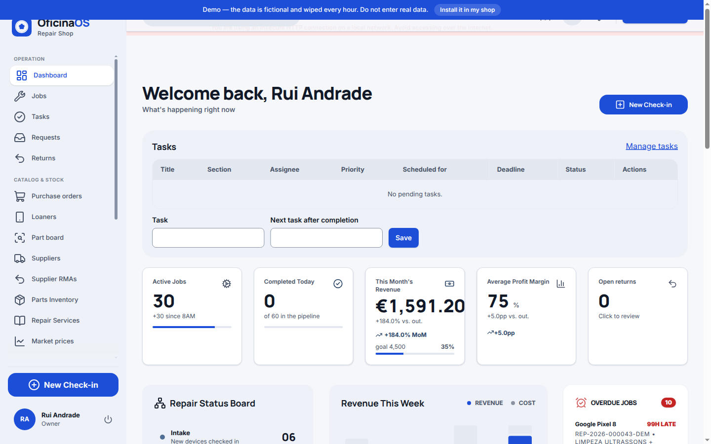
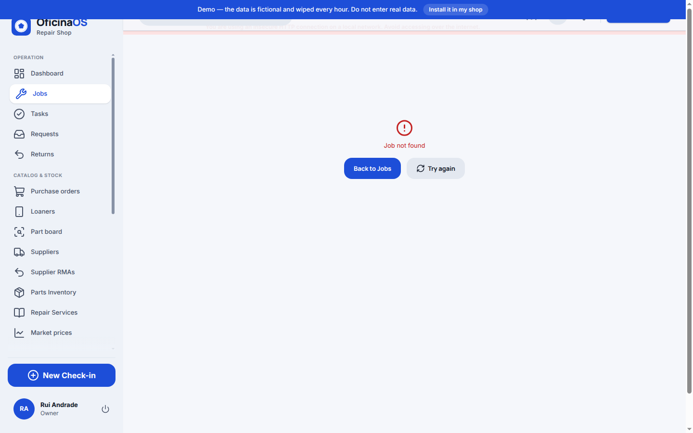
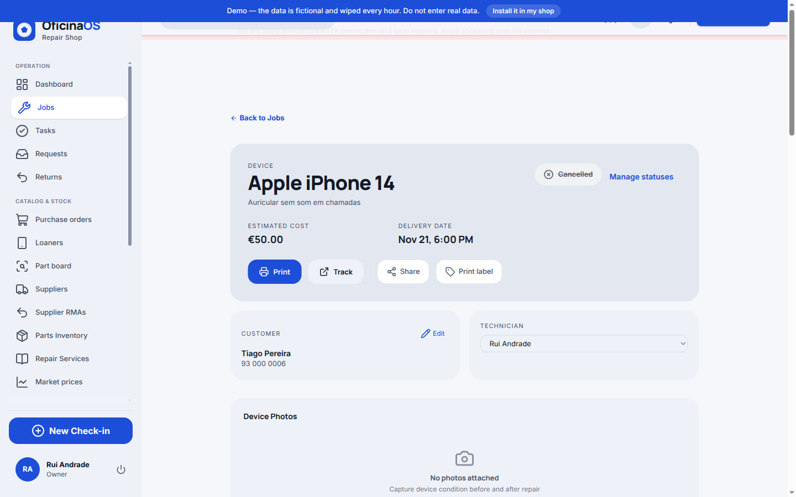
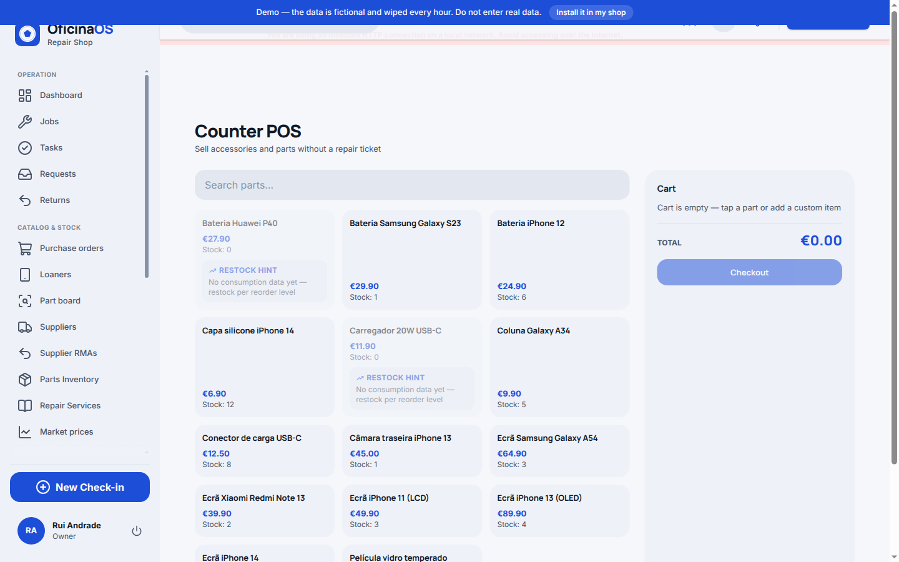
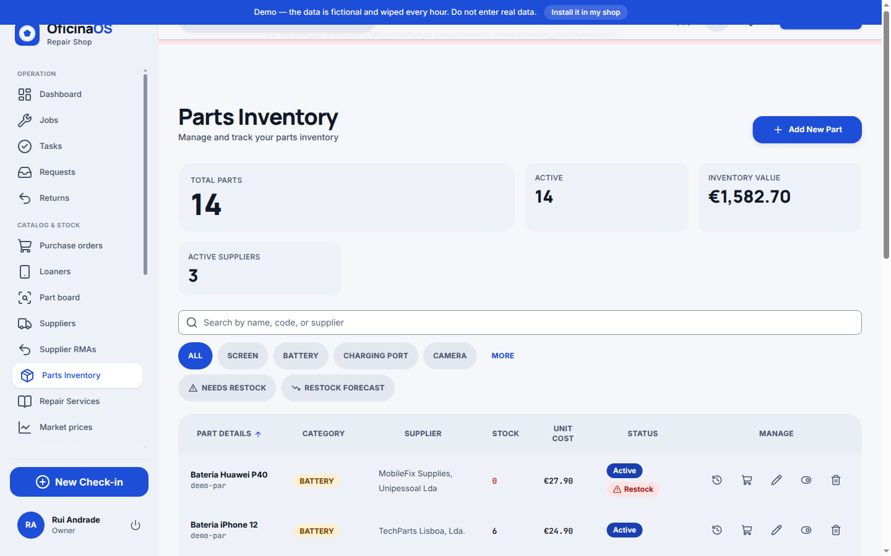
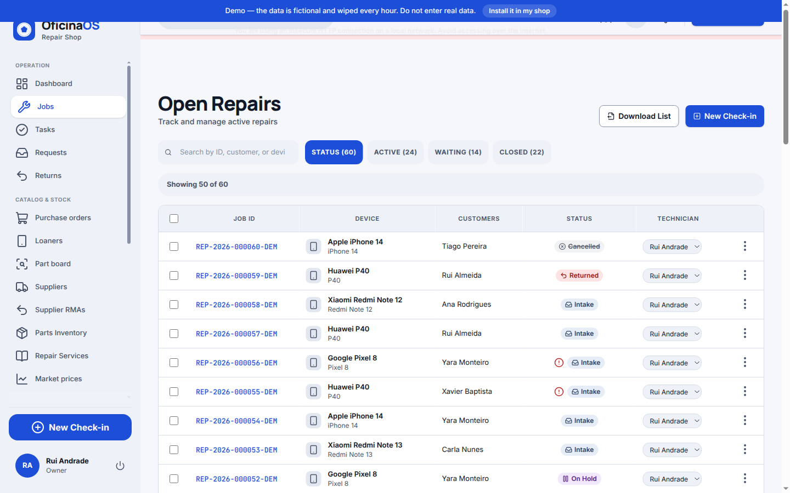
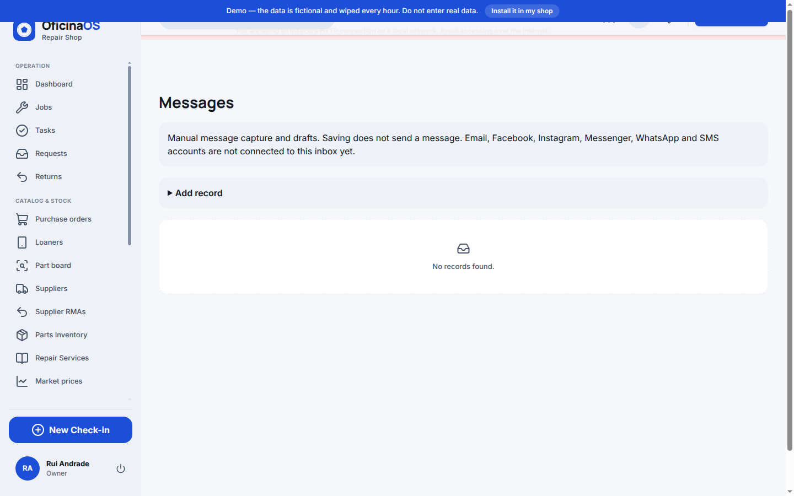
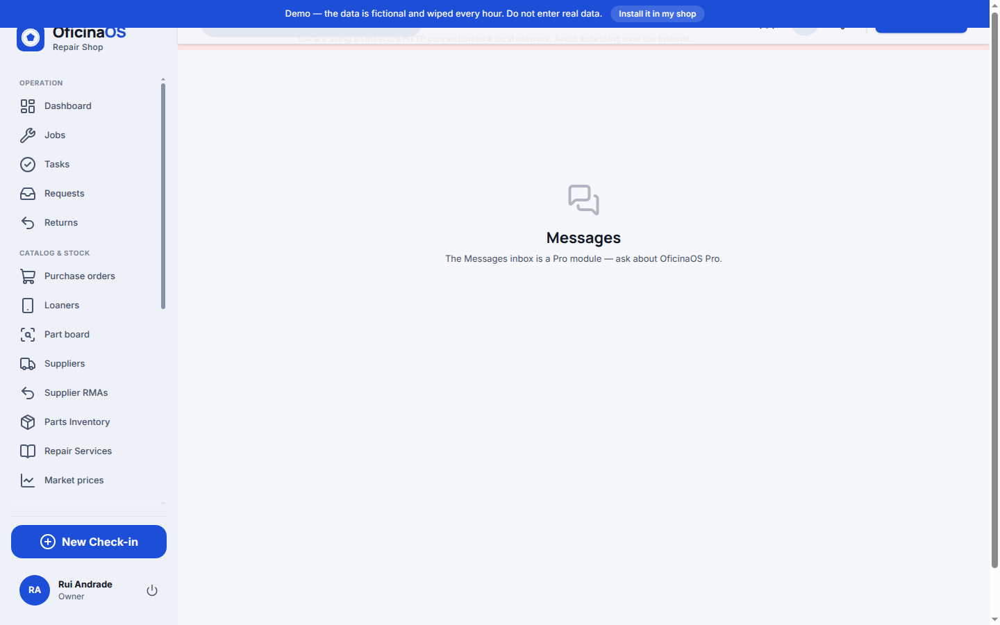
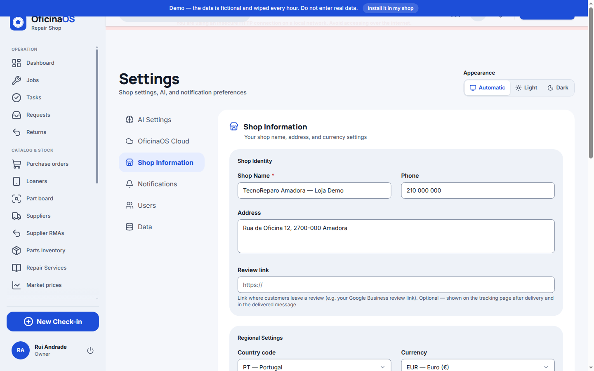
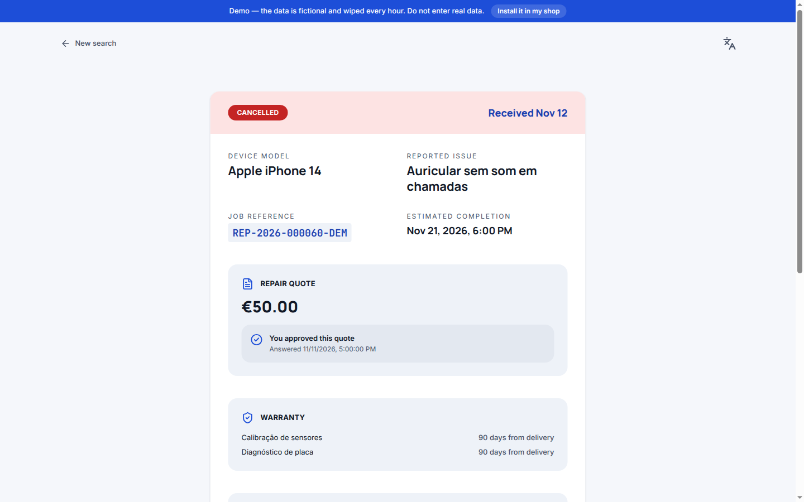

<p align="center">
  
</p>

<h1 align="center">OficinaOS</h1>

<p align="center">
  <b>Repair shop management for single-location phone repair shops — self-hosted, MIT-licensed, free forever.</b>
</p>

<p align="center">
  <a href="https://github.com/braindeadpt/OficinaOS/actions/workflows/ci.yml"></a>
  <a href="https://github.com/braindeadpt/OficinaOS/releases/latest"></a>
  <a href="./LICENSE"></a>
</p>

<p align="center">
  <a href="https://demo.oficinaos.app">Live demo</a> ·
  <a href="https://github.com/braindeadpt/OficinaOS/releases/latest">Download for Windows</a> ·
  <a href="./INSTALL.md">Install guide</a> ·
  <a href="./docs/ecosystem.md">Ecosystem</a>
</p>

---

**English** | [Português (PT-PT)](./docs/i18n/readme-pt.md)

Register the device intake, track the repair, deliver it back to the customer — all in one app that runs on a machine in your shop and is reachable from any browser on the shop network. Certified invoicing optionally available via InvoiceXpress (Pro module).

**Four UI languages included: Portuguese (PT-PT), English, French, Spanish.**

> **Fork of [Reparilo](https://github.com/cranknet/reparilo)** by Bechar Gherbi — adapted for the Portuguese market, with a complete European Portuguese locale and LAN-ready Docker deployment. Renamed as required by the original project's license; the "Reparilo" name is not covered by the MIT license.

## Screenshots

<p align="center">
  
</p>

| Intake with digital signature | Job detail & timeline |
| :---: | :---: |
|  |  |
| **Counter POS** | **Parts inventory** |
|  |  |
| **Jobs board** | **Team messages** |
|  |  |
| **WhatsApp/AI inbox** | **Settings** |
|  |  |

<p align="center">
  <b>Customer-facing tracking page</b> — the customer scans a QR code on the receipt and follows the repair on their phone, no app to install:<br/><br/>
  
</p>

## Features

- **Complete repair workflow** — intake → diagnosis → repair → delivery, with photos, status timeline and customer notifications
- **Full intake record** — functional checklist, unlock code/pattern and the customer's digital signature on the receipt
- **QR receipts & tracking** — the customer scans a QR code and follows the repair status on their phone, nothing to install
- **Public pre-check** — a form customers use to request a quote/diagnosis online; requests land in the shop queue
- **Quotes** — versioned, with accepted/declined responses on record
- **Counter POS** — sell parts and accessories, cash sessions and payments
- **Returns & warranties** — separate flows for rework and warranty claims
- **Trade-in (used devices)** — legally required seller details and device grading
- **Parts & stock** — inventory with low-stock alerts and restock suggestions
- **Printing** — receipts and labels on network ESC/POS thermal printers (58/80 mm) or A4
- **Reports & exports** — sales, repairs and margins per period; CSV export; monthly revenue goal
- **OficinaDiag** — free Windows app that reads a phone over USB (battery, screen, sensors) and sends the diagnostic to the shop
- **AI assistant** (optional) — bring your own OpenAI key; stored encrypted with AES-256 at rest
- **WhatsApp/email notifications** (optional) — editable templates in settings
- **Pro modules** (optional, via OficinaOS Cloud) — public customer portal, WhatsApp bot, SMS channel, AI reports and InvoiceXpress invoicing
- **PWA + Android (Capacitor)** — installable on the home screen on iOS/Android, or a native APK for shop tablets
- **Single-tenant by design** — built for one shop, not a SaaS

## How it works

```
Browser (PC, tablet, phone on the shop network)
        ↓
   OficinaOS (Fastify + React)
        ↓
   PostgreSQL
```

One machine runs the server and database; every other device connects through the browser. The core workflows **run without internet** — AI and WhatsApp are optional extras.

## Installation

### Easy install (Windows) ⭐

Download **[OficinaOS-Setup.exe](https://github.com/braindeadpt/OficinaOS/releases/latest)** — a normal Windows installer: runs as a service, starts with the PC, tray icon, no Docker or console windows. Administrator rights only for the install itself.

Alternatives: **[oficinaos-portable.zip](https://github.com/braindeadpt/OficinaOS/releases/latest/download/oficinaos-portable.zip)** (~470 MB, Bun + PostgreSQL embedded — no admin, nothing to install) or the **[Docker ZIP installer](https://github.com/braindeadpt/OficinaOS/releases/latest/download/oficinaos-install.zip)** (`INSTALAR.bat` — for NAS/Linux and Docker users). Differences, backups and restore: **[INSTALL.md → Portable install](./INSTALL.md)**.

> The release ZIP contains only the install files. For the full source: **Code → Download ZIP** (always the latest `main`).

Full step-by-step guide: **[INSTALL.md](./INSTALL.md)**

### Manual Docker (recommended for Linux/Mac)

Requirements: [Docker Desktop](https://www.docker.com/products/docker-desktop/) (Windows/Mac) or Docker Engine (Linux). Nothing else needs installing.

```bash
git clone https://github.com/braindeadpt/OficinaOS.git
cd OficinaOS

cp .env.example .env
# Edit .env — fill in BETTER_AUTH_SECRET, AI_ENCRYPTION_KEY,
# COOKIE_SECRET, SETUP_TOKEN and APP_URL (the machine IP on the LAN).
# Generate secrets with:
#   node -e "console.log(require('node:crypto').randomBytes(48).toString('base64url'))"

docker compose up -d --build
docker compose exec app bun run db:seed   # first time only (initial data)
```

Then open `http://<machine-ip>:4000/setup?token=<SETUP_TOKEN>` (the value you set in `.env`) and create your shop on the **"Create your workshop"** screen: shop name, your name, username/email and password. There are no default credentials. Under Docker the token is always required (the browser reaches the container through the Docker network, not as `127.0.0.1`); once the first user exists the setup screen is gone.

### Docker commands

```bash
docker compose up -d        # start
docker compose down         # stop (data stays in the volumes)
docker compose logs -f app  # app logs
docker compose restart app  # restart after build changes
```

### LAN deployment notes (HTTP)

This fork includes patches to run over plain HTTP inside a trusted LAN (no TLS): session cookies without `Secure`, CSP without `upgrade-insecure-requests`, HSTS disabled.

- Always access the app through the **same URL configured in `APP_URL`** — mixing `localhost` and the IP causes invalid-origin errors
- If you expose the app outside the shop network, **use HTTPS** — the HTTP configuration is for private LANs only. The simplest path: **[remote access via Cloudflare Tunnel](docs/remote-access.md)**, no open ports, no public IP
- If the machine IP changes, update `APP_URL` in `.env` and run `docker compose up -d`

## Phones and tablets

The app is responsive and installable as a **PWA** (home-screen icon, full screen) — iPhone, iPad and Android, on the shop network or remotely. A **Capacitor** configuration is also ready to build a native Android APK without the Play Store.

Full guide: **[docs/mobile-access.md](docs/mobile-access.md)**

## Remote access (optional)

With the shop PC on, a free **Cloudflare Tunnel** exposes the app over HTTPS — for staff outside the shop and for customer links (tracking, quotes, pre-check, warranty receipt/QR). No port-forwarding, no public IP, works behind CGNAT.

```bash
# .env
TUNNEL_TOKEN=eyJh…        # tunnel token (Cloudflare Zero Trust)
EXTRA_TRUSTED_ORIGINS=https://oficina.yourdomain.pt
```

```bash
docker compose --profile tunnel up -d
```

Step-by-step guide: **[docs/remote-access.md](docs/remote-access.md)**

## Backups and restore testing (db-backup sidecar)

The compose file ships a `db-backup` sidecar that dumps PostgreSQL daily (14-day retention, configurable with `RETENTION_DAYS`) and, with a remote destination enabled, copies each dump to object storage and verifies the restore weekly. Status visible in **Settings → Shop → Backups**.

### Restore test on a real database (local procedure)

The full cycle — dump → wipe → restore → data intact — can be reproduced on your machine with Docker in ~5 minutes:

```bash
git clone https://github.com/braindeadpt/OficinaOS.git
cd OficinaOS
cp .env.example .env    # no secrets needed for this test

# Start the database and the backup sidecar
# (the sidecar dumps on start and then every 24h)
docker compose up -d db db-backup

# Probe table with known data
docker compose exec db psql -U reparilo -d reparilo \
  -c "CREATE TABLE restore_probe (id serial primary key, marker text);" \
  -c "INSERT INTO restore_probe (marker) VALUES ('pre-backup-marker');"

# Backup that already includes the probe table
docker compose exec db-backup /scripts/run-backup.sh

# Destroy the data (DROP SCHEMA) and restore the dump
docker compose exec db psql -U reparilo -d reparilo \
  -c "DROP SCHEMA public CASCADE; CREATE SCHEMA public;"
docker compose exec db-backup /scripts/run-restore.sh \
  "$(docker compose exec -T db-backup sh -c 'ls -1t /backups/oficinaos-*.sql.gz | head -1')"

# Confirm the marker survived the cycle
docker compose exec db psql -U reparilo -d reparilo \
  -c "SELECT count(*) FROM restore_probe WHERE marker = 'pre-backup-marker';"
# → must return 1
```

> ⚠️ **Never point the restore at a database with real data** — `run-restore.sh` replaces everything. The script pauses 10 s before destroying data unless `RESTORE_AUTO_CONFIRM=1` is set (used by CI).

### Off-site copy (object storage via rclone)

In the installation's `.env`, enable the second destination and configure the rclone remote through env vars (S3, B2, GCS, MinIO…):

```bash
BACKUP_REMOTE_ENABLED=true
BACKUP_RCLONE_REMOTE=s3:oficinaos-backups        # or gcs:…, b2:…
RCLONE_CONFIG_S3_TYPE=s3
RCLONE_CONFIG_S3_ACCESS_KEY_ID=...
RCLONE_CONFIG_S3_SECRET_ACCESS_KEY=...
# RCLONE_CONFIG_S3_ENDPOINT=...                  # only for MinIO/R2
```

What the sidecar does per daily backup:

1. Local dump + retention (as always);
2. `rclone copyto` of the dump to the bucket + `last-remote-copy.txt` heartbeat;
3. Remote retention (`--min-age 14d`);
4. Once a week (`RESTORE_CHECK_INTERVAL_DAYS`, default 7): downloads the newest dump from the bucket and restores it into the disposable `restore_check` database — **the live database is never touched**. The result lands in the `last-restore-check.txt` heartbeat.

A failing remote copy or verification never invalidates the local dump; the UI indicators (remote copy / verified restore) stay red "overdue" until the next successful run. The **DB backup/restore round-trip** CI job exercises this entire chain against a real S3 endpoint on every PR.

### Manual restore (disaster)

```bash
docker compose exec -T db-backup /scripts/run-restore.sh oficinaos-<stamp>.sql.gz
```

The script lists available files with `docker compose exec db-backup ls -1t /backups`. In production, always confirm the file name before hitting Enter — the restore replaces the entire database.

## Configuration

Every environment variable is documented in [`.env.example`](./.env.example). In production the server refuses to boot when mandatory secrets are missing.

| Variable | Description |
|---|---|
| `APP_URL` | Public app URL (e.g. `http://192.168.1.33:4000`) |
| `DATABASE_URL` | PostgreSQL connection (set by compose) |
| `BETTER_AUTH_SECRET` | Session secret (generate randomly) |
| `SETUP_TOKEN` | Optional — one-time code for the "Create your workshop" screen from another device (Docker/server). Without it, only works on `localhost` |
| `SEED_ADMIN_PASSWORD` | Dev/CI/E2E only — when set, `db:seed` creates the `admin` user (with forced password change) when the database has no users |
| `SEED_ADMIN_EMAIL` | Optional, with the above — seeded admin email (defaults to `admin@oficinaos.local`) |
| `AI_ENCRYPTION_KEY` | AES-256 key for storing the OpenAI key |
| `OPENAI_API_KEY` | Optional — AI assistant |
| `WHATSAPP_*`, `EMAIL_*` | Optional — customer notifications |
| `DEMO_MODE` | `true` enables the public demo (next section) — **never on a real install** |

## Public demo (`demo.oficinaos.app`)

`DEMO_MODE=true` turns the installation into a public demo: the visitor clicks "Try the demo", enters a pre-filled fictional shop (customers, repairs, stock, sales — all invented) and uses everything without installing anything.

**What changes with `DEMO_MODE=true`:**

- `POST /api/demo/login` creates a shop-owner session with no password; `/setup` is disabled and an empty database is seeded automatically on boot
- The server **refuses to boot** if any real secret is set — by prefix (`OPENAI_`, `EMAIL_`, `WHATSAPP_`, `SMTP_`, `META_`, `EVOLUTION_`, `OFICINAOS_CLOUD_`, `CLOUD_`, `GITHUB_`, `INVOICEXPRESS_`, `IX_`, `TRADE_`, `MARKET_`, `S3_`, `R2_`, `AWS_`, `BACKUP_`, `SEED_ADMIN_`, `SETUP_TOKEN`) **or by suffix** (`*_TOKEN`, `*_SECRET`, `*_PASSWORD`, `*_PASS`, `*_KEY`, `*_API_KEY`, `*_APIKEY`, `*_CREDENTIALS`, `*_DSN`). The only exceptions: `BETTER_AUTH_SECRET`, `COOKIE_SECRET` and `AI_ENCRYPTION_KEY`, which never leave the container
- Everything outbound is disabled **on the server** (not just the UI): email, WhatsApp/SMS, webhooks, AI assistant, Cloud and Trade pairing/sync, InvoiceXpress, feedback→GitHub, self-update, ESC/POS printer, exports
- Blocked with 403: user/role management, password/email change, keys and integrations, credential sign-in (only `/api/demo/login` creates sessions — failures never lock the demo account), imports above 50 rows
- The guard runs on the **decoded** path (URL-encoded variants like `/api/%75sers/...` are rejected before the router)
- Uploads: 1 MB max per file, images only (MIME + magic bytes validation), 200 MB total quota
- Tighter rate limits (demo login 20/15min per IP; writes ≤60/min) — behind cloudflared the key is `CF-Connecting-IP`, so visitors don't all share the tunnel IP. The header is only honored when the peer is private/edge (the cloudflared connector or proxy) or with `DEMO_TRUST_CF_CONNECTING_IP=true` — **the origin must be reachable only through cloudflared** (or the edge proxy must overwrite/strip the header), otherwise direct clients forge the header and get unlimited budget
- External schedulers (Cloud poller, remarketing, outbox) never start
- A fixed banner at the top warns "Demo — the data is fictional and wiped every hour" with the "Install it in my shop" CTA

**Seed:** `bun run db:seed:demo` generates the deterministic dataset (fixed-seed PRNG — same shape on every run, dates relative to "now") and writes the snapshot to `demo-snapshot.json` (or `DEMO_DUMP_PATH`). As a second guard, `seedDemo`/`demo:reset` refuse to run against a database whose name doesn't contain `demo`.

**Hourly reset:** the infra timer runs `docker exec demo-web bun run demo:reset` — regenerates the dump (always-fresh dates), TRUNCATE+replay **in a single transaction** (`lock_timeout=10s`, 60 s timeout) and wipes upload contents. The app keeps responding during the reset — readers see the before or after state, never a half-written database; the command is idempotent and runs entirely inside the container.

**Example deployment:** [`compose.demo.yaml`](./compose.demo.yaml) — app + Postgres with pinned image tags, `read_only` + `tmpfs /tmp`, `cap_drop ALL`, `no-new-privileges`, memory/CPU/PID limits, sealed `internal` network and **no published ports** (only the `edge` network), with [`.env.demo.example`](./.env.demo.example). The reverse proxy on the edge points `demo.oficinaos.app` at `demo-web:4000`.

## Local development (no Docker)

Requirements: [Bun](https://bun.sh) `1.3.13` and PostgreSQL.

```bash
bun install
cp .env.example .env          # fill in secrets
bun run db:migrate
bun run db:seed
bun run dev                   # http://localhost:5173
```

```bash
bun run test         # vitest
bun run check        # ultracite lint
bun run fix          # auto-fix lint
bun run db:studio    # Prisma Studio
```

## Translations and i18n

Locales live in `src/i18n/locales/` (`pt`, `en`, `fr`, `es`). Workflow for new strings:

1. Add the key in `src/i18n/locales/en.json`
2. `bun run sync-locales` — syncs and auto-translates the other locales
3. `python scripts/fix-pt-pt.py` — normalizes the generated Portuguese to PT-PT (Google leans towards pt-BR)

Hardcoded UI strings are rejected in review.

## The OficinaOS ecosystem

This repo is the shop app — one of **4 interconnected repositories**:

| Repo | What it is |
|---|---|
| **[OficinaOS](https://github.com/braindeadpt/OficinaOS)** (this one) | The shop app — MIT, self-hosted, free forever |
| **[oficinaos-cloud](https://github.com/braindeadpt/oficinaos-cloud)** | Pro entitlement server — modules are gated server-side, nothing to crack client-side |
| **[oficinaos-website](https://github.com/braindeadpt/oficinaos-website)** | Marketing site and user-facing documentation |
| **[oficinaos-diag](https://github.com/braindeadpt/oficinaos-diag)** | Free Windows USB diagnostics tool for shops |

The canonical map — data flows, module IDs, where everything lives — is [docs/ecosystem.md](./docs/ecosystem.md).

## Contributing

See [CONTRIBUTING.md](./CONTRIBUTING.md). In short: open an issue before large PRs, run `bun run check` and `bun run test`, and keep each PR focused on one thing.

## Security

Found a vulnerability? See [SECURITY.md](./SECURITY.md) — **do not** open a public issue.

## Code signing policy

Free code signing provided by [SignPath.io](https://signpath.io/), certificate by [SignPath Foundation](https://signpath.org/) *(pending SignPath Foundation onboarding; releases prior to workflow integration are unsigned)*.

- **Signed artifacts:** Once SignPath integration is enabled in [`.github/workflows/release.yml`](./.github/workflows/release.yml), Windows release binaries built by this project (`OficinaOS-Setup.exe` and `OficinaOSTray.exe`) will be signed exclusively from tagged commits on `main`. Third-party open-source runtimes bundled inside the installer (Bun, PostgreSQL, WinSW) are included as distributed upstream and are not re-signed with the project certificate.
- **Team roles:**
  - **Committers and reviewers:** [@braindeadpt](https://github.com/braindeadpt)
  - **Approvers:** [@braindeadpt](https://github.com/braindeadpt) (every release signing request requires manual approval)
- **Privacy:** This program will not transfer any user or shop data to other networked systems unless specifically requested by the user or the person installing or operating it. When an administrator opens the dashboard, the app performs a read-only update check against GitHub Releases (`api.github.com`, no telemetry or shop data sent). All other external integrations (remote access tunnel, WhatsApp/SMS notifications, AI assistant, OficinaOS Cloud) are optional, disabled by default, and documented in [docs/privacy-and-data.md](./docs/privacy-and-data.md).

## License

[MIT](./LICENSE) © 2026 Bechar Gherbi (original project), changes © braindeadpt. The "Reparilo" name belongs to the original author and is not licensed — this fork uses the name **OficinaOS**.
